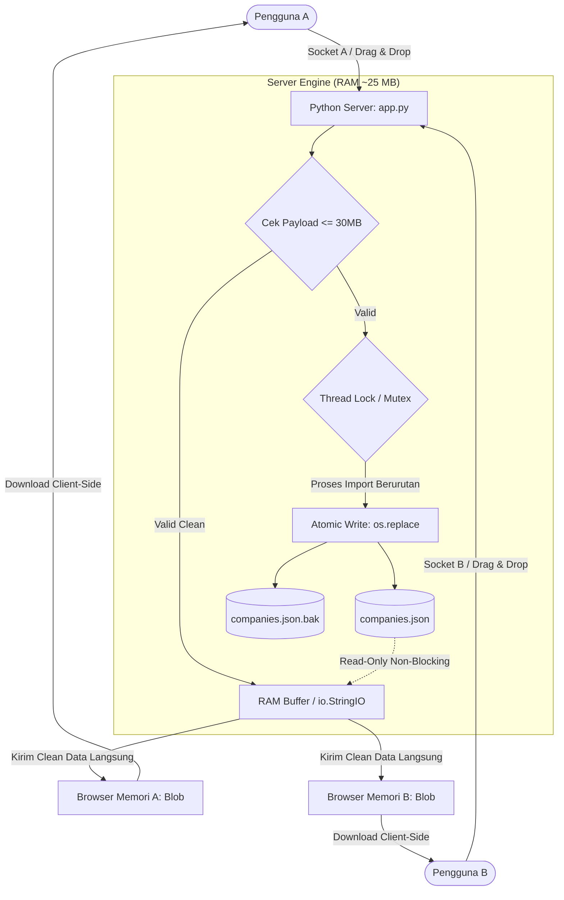

# Rencana Implementasi: Python Web UI (Drag & Drop, In-Memory, RAM < 30 MB)

Dokumen ini memuat rencana perancangan dan implementasi **Python Web UI** untuk pengolahan scraper lowongan kerja sesuai dengan batasan memori server (sisa RAM ~365 MB), kebutuhan privasi/penyimpanan disk (tidak menyimpan file input maupun output di server), **keamanan penggunaan bersamaan oleh banyak pengguna tanpa login/session**, serta **proteksi ketahanan server terhadap error dan beban ekstrem**.

---

## 1. Analisis Kebutuhan & Batasan Kritis

| Komponen | Spesifikasi / Batasan |
| :--- | :--- |
| **Konsumsi RAM** | Harus di bawah **30–40 MB** agar sangat aman untuk sisa RAM 365 MB pada server. |
| **Penyimpanan File** | **STRICT ZERO DISK STORAGE**: File input pengguna dan file output hasil cleaning diproses langsung di memori RAM (`io.StringIO`), **tidak ada file CSV yang disimpan ke hard disk server**. |
| **File JSON** | `companies.json` adalah satu-satunya file yang dipertahankan di server sebagai basis data perusahaan unik. |
| **Dependensi** | 100% menggunakan Python Standard Library (`http.server`, `csv`, `json`, `io`, `threading`, `os`, `shutil`). Tanpa perlu `pip install`, langsung jalan cepat & stabil. |
| **Akses Pengguna** | **Multi-User Bebas Login/Session**: Dapat digunakan oleh 2 orang atau lebih secara bersamaan tanpa akun, login, cookie, atau session storage. |

---

## 2. Solusi Konkurensi & Penggunaan Bersamaan (Multi-User Safety)

Untuk memastikan sistem berjalan 100% aman saat digunakan oleh 2 orang secara bersamaan, diterapkan mekanisme berikut:

### A. Penanganan Skenario Penggunaan Bersamaan
1. **Cleaning vs Cleaning (Dua orang membersihkan data bersamaan):**
   - Operasi cleaning murni membaca (`read-only`) data dari `companies.json`.
   - Pembacaan bersamaan bersifat *non-blocking* di level OS sehingga 100% aman tanpa antrean atau konflik.
2. **Import vs Import (Dua orang mengimpor company baru bersamaan):**
   - Dilindungi dengan antrean pengaman (`threading.Lock()`). Permintaan import kedua akan diproses tepat setelah import pertama selesai sehingga **tidak ada data perusahaan yang tertimpa (*lost update*)**.
3. **Import vs Cleaning (Satu orang mengimpor, satu orang membersihkan):**
   - Menggunakan teknik **Atomic Write** (`os.replace`). File `companies.json` tidak pernah berada dalam kondisi setengah tertulis. Pengguna yang melakukan cleaning akan selalu membaca data yang utuh dan valid.

### B. Mekanisme Tanpa Login / Tanpa Session (Stateless Architecture)
Bagaimana program mengenali dan memisahkan 2 orang tanpa perlu sistem login/session?
1. **Koneksi Jaringan Terisolasi (TCP Socket):**
   - Setiap browser memiliki pipa koneksi mandiri ke server. Server merespons langsung ke koneksi komputer yang mengirim file.
2. **Teknik Client-Side Memory (Blob Handling):**
   - Saat pengguna mengklik "Clean Now", server membersihkan file di RAM dan langsung mengirimkan teks data bersih ke browser pengguna.
   - Browser menyimpan data tersebut di memori komputernya sendiri sebagai objek `Blob`.
   - Ketika pengguna mengklik **"Download Clean File"**, browser langsung mengunduhnya dari memori lokalnya menggunakan `URL.createObjectURL(blob)`.
   - **Hasil:** Server tidak perlu menyimpan session atau antrean file hasil download. Data kedua pengguna 100% terisolasi dan tidak mungkin tertukar.

### C. Beban RAM untuk 2 Pengguna Bersamaan
- 1 pengguna aktif: ~20 MB – 25 MB RAM total.
- 2 pengguna aktif memproses bersamaan: **~25 MB – 35 MB RAM total** (hanya bertambah ~5-10 MB).
- Sangat aman dan stabil untuk server dengan sisa RAM 365 MB.

---

## 3. Manajemen Risiko & Proteksi Ketahanan Server (Fault Tolerance)

Untuk mencegah server mengalami *crash*, *freeze*, atau kehabisan memori akibat kesalahan proses, disiapkan 5 lapis pengamanan:

| Skenario Bahaya | Risiko ke Server | Mekanisme Proteksi yang Diterapkan | Status |
| :--- | :--- | :--- | :---: |
| **File Bom / Ukuran Ekstrem** | Server OOM Crash (Mati kehabisan RAM) | **Batas Maksimal Upload 30 MB**: Cek header `Content-Length`. Jika > 30 MB, server langsung menolak (*HTTP 413*) sebelum file masuk ke RAM. | **Aman** |
| **Deskripsi Panjang & Encoding Rusak** | Parser macet (`_csv.Error`, `UnicodeError`) | **Unlimited Buffer Limit**: `csv.field_size_limit(2147483647)` + Deteksi multi-encoding (`utf-8-sig`, `cp1252`, `latin-1`) dengan `errors='replace'`. | **Aman** |
| **File JSON Rusak / Terhapus** | Server mogok total saat startup / read | **Auto-Backup & Recovery**: Setiap proses import otomatis membuat salinan `companies.json.bak`. Jika file utama korup, sistem otomatis pulih dari cadangan. | **Aman** |
| **Salah Upload File / Kolom Hilang** | Data kosong / baris terhapus semua keliru | **Validasi Header Awal**: Server memeriksa keberadaan kolom `employer_company_name`. Jika tidak ada, proses dibatalkan aman & kirim pesan di log UI. | **Aman** |
| **Koneksi Putus / Tab Ditutup Mendadak** | Memory leak / proses menggantung | **Try-Except BrokenPipe & Finally Cleanup**: Menangkap pemutusan koneksi tanpa crash dan otomatis melepas memori RAM seketika. | **Aman** |

---

## 4. Struktur Tampilan (3 Halaman / Tab)

Aplikasi dibangun sebagai antarmuka tunggal (**Single Page Application**) modern berbasis tab:

```
+-------------------------------------------------------------------------+
|  [CLEANJOB AI]  | [1] Import to JSON | [2] Clean Scraper | [3] Company DB |
+-------------------------------------------------------------------------+
|                                                                         |
|  [ AREA KONTEN AKTIF SESUAI TAB YANG DIPILIH ]                          |
|                                                                         |
|  - Area Drag & Drop File                                                |
|  - Tombol Aksi Utama (Import / Clean Now)                               |
|  - Terminal / CMD Process Log (Console bergaya retro/modern)           |
|  - Tombol Tindakan Lanjutan / Modal Popup                               |
|                                                                         |
+-------------------------------------------------------------------------+
```

### Halaman 1: Import File to JSON
1. **Area Drag & Drop File**:
   - Pengguna menarik (*drag*) file CSV atau mengklik untuk memilih file dari komputer.
   - Menampilkan nama file dan ukuran file yang dipilih.
2. **Tombol "Import Company"**:
   - Menjalankan proses ekstraksi kolom `employer_company_name`.
3. **Live Terminal / CMD Log**:
   - Menampilkan log proses baris per baris secara *real-time* (seperti terminal CMD):
     - Membaca baris CSV
     - Mendeteksi kolom `employer_company_name`
     - Menghitung company duplikat yang diabaikan
     - Menghitung company baru yang ditambahkan ke `companies.json`
4. **Pop-up Selesai**:
   - Memunculkan modal dialog elegan bertuliskan **"Import Selesai"** beserta ringkasan jumlah company baru yang ditambahkan.
5. **Kebijakan Penyimpanan**: File CSV pengguna **tidak disimpan di hard disk server**.

---

### Halaman 2: Cleaning Data Scraper
1. **Area Drag & Drop File**:
   - Pengguna menarik file CSV scraper baru yang ingin dibersihkan.
2. **Tombol "Clean Now"**:
   - Menjalankan proses pembersihan data terhadap daftar perusahaan di `companies.json`.
3. **Live Terminal / CMD Log**:
   - Menampilkan log proses secara langsung:
     - Jumlah baris awal
     - Jumlah baris dihapus (sudah ada di JSON)
     - Jumlah baris dihapus (duplikat internal di dalam file)
     - Sisa baris bersih (fresh data)
4. **Dua Tombol Aksi Pasca-Cleaning**:
   - **Tombol "Download Clean File"**: Memicu browser mengunduh file CSV hasil cleaning yang tersimpan di memori browser pengguna (`cleaned_<nama_file>.csv`).
   - **Tombol "Clean Another File"**: Me-reset halaman dan formulir agar pengguna dapat langsung memasukkan file berikutnya untuk dibersihkan.
5. **Kebijakan Penyimpanan**: File CSV input maupun file CSV hasil clean **tidak disimpan di server**.

---

### Halaman 3: List Company di File JSON
1. **Statistik Data**:
   - Menampilkan total jumlah perusahaan unik yang saat ini terdaftar di `companies.json`.
2. **Pencarian Real-Time (Live Search)**:
   - Kolom pencarian instan untuk memfilter dan mengecek apakah suatu nama perusahaan sudah ada di basis data.
3. **Daftar Perusahaan (Grid / Badge Card)**:
   - Daftar nama perusahaan yang tersusun rapi, bersih, dan berurutan secara alfabetis.

---

## 5. Arsitektur Teknis



---

## 6. Rencana Tahapan Eksekusi

1. **Pembuatan Backend Server (`app.py`)**:
   - Implementasi `http.server.ThreadingHTTPServer` (Zero external dependencies).
   - Batasan `MAX_CONTENT_LENGTH = 30 * 1024 * 1024` (30 MB).
   - Mekanisme `threading.Lock()` dan `atomic_save_json()` dengan auto-backup `.bak`.
   - In-memory CSV streaming via `io.StringIO` dan `csv.field_size_limit(2147483647)`.
   - Endpoint `POST /api/import` (in-memory parse, log generation, thread-safe JSON update).
   - Endpoint `POST /api/clean` (in-memory clean & return data CSV teks + stats log).
   - Endpoint `GET /api/companies` (ambil list company dari JSON).
2. **Pembuatan Frontend Web UI (`templates/index.html` atau embedded)**:
   - Tema modern dark mode / glassmorphism, responsive, dan ramah pengguna.
   - Tab 1: Drag & drop import, tombol import, terminal box CMD, popup modal konfirmasi.
   - Tab 2: Drag & drop clean, tombol "Clean Now", terminal box CMD, tombol "Download Clean File" via client-side Blob, tombol "Clean Another File".
   - Tab 3: Tampilan list company dari JSON, badge hitungan total, dan live search bar.
3. **Verifikasi & Pengujian Fungsionalitas**:
   - Uji drag-and-drop dengan file contoh (`1B NSW - Sheet1.csv`, `24 NSW - Sheet1.csv`).
   - Uji penolakan file ukuran > 30 MB.
   - Uji simulasi konkurensi (dua request bersamaan).
   - Pastikan tidak ada file CSV temporer yang tertinggal di folder server.
   - Uji download file hasil clean langsung dari memori browser.
   - Ukur konsumsi RAM (target: < 35 MB).
